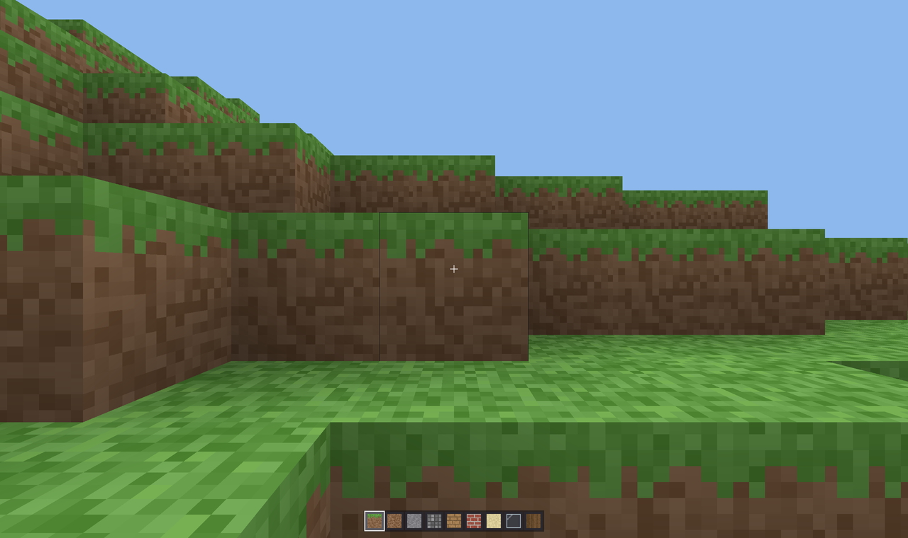

# ArchCraft

A small Minecraft-style voxel engine in C++20, SDL3 and OpenGL 3.3 — written to be **read**.

It is a real engine: infinite streamed terrain, chunk meshing with ambient occlusion,
block breaking and placing, AABB physics, frustum culling. It is also deliberately small
(~3,000 lines) with no dependencies beyond SDL, so you can follow every line from
`main()` to the pixels on screen.



---

## Build and run

```bash
brew install sdl3 cmake          # macOS; see below for Linux/Windows
cmake -S . -B build
cmake --build build -j
./build/archcraft
```

Options:

```
--seed N              world seed (default 1337)
--render-distance N   chunks around the player, 2..24 (default 8)
--frames N            render N frames then exit (used for testing)
--screenshot FILE     save the final frame as a TGA
--dump-atlas          write the generated texture atlas to atlas.tga
```

| Control | Action | Control | Action |
|---|---|---|---|
| `W A S D` | move | left click | break block |
| mouse | look | right click | place block |
| `Space` | jump / swim up | `1`–`9`, scroll | pick block |
| `Left Ctrl` | sprint | `F` | toggle fly |
| `Left Shift` | descend (flying) | `F2` | screenshot |
| `Esc` | release mouse, again to quit | | |

The window title is the debug readout: FPS, position, chunk counts, triangles.

**Linux:** install SDL3 (`libsdl3-dev`, or build from source) — the project ships a tiny
OpenGL function loader so no GLEW/GLAD is needed.
**Windows:** `vcpkg install sdl3`, then configure with the vcpkg toolchain file.

---

## Where to start reading

Read in this order; each file is commented to explain *why*, not just *what*.

1. **[`src/main.cpp`](src/main.cpp)** — the game loop. Four steps: input, simulate, render, present.
   Everything else hangs off one of those lines.
2. **[`src/world/Chunk.h`](src/world/Chunk.h)** — why the world is cut into 16×128×16 boxes.
3. **[`src/world/ChunkMesher.cpp`](src/world/ChunkMesher.cpp)** — the heart of the engine: turning
   32,768 blocks into a few thousand triangles.
4. **[`src/gfx/Mesh.h`](src/gfx/Mesh.h)** + **[`assets/shaders/block.vert`](assets/shaders/block.vert)** —
   how geometry reaches the GPU and becomes pixels.
5. **[`src/world/TerrainGen.cpp`](src/world/TerrainGen.cpp)** — noise in, landscapes out.
6. **[`src/player/Player.cpp`](src/player/Player.cpp)** — gravity, collision, and editing the world.

Then the long-form explanations in [`docs/`](docs/):

| Doc | Covers |
|---|---|
| [01 — The frame](docs/01-the-frame.md) | the game loop, delta time, vsync, why `dt` is clamped |
| [02 — The GPU pipeline](docs/02-gpu-pipeline.md) | vertices → matrices → triangles → fragments; depth, culling, blending, fog |
| [03 — Chunks and meshing](docs/03-chunks-and-meshing.md) | face culling, ambient occlusion, the texture atlas, chunk borders |
| [04 — World generation](docs/04-world-generation.md) | Perlin noise, fbm, biomes, caves, determinism |
| [05 — Physics and raycasting](docs/05-physics-and-raycasting.md) | AABB collision, per-axis resolution, DDA voxel traversal |
| [06 — Roadmap](docs/06-roadmap.md) | what to build next, in order, with the reasoning |

---

## Architecture

```
src/
├── main.cpp            the game loop
├── core/               SDL window, GL context, input, frame timing
│   ├── Window.*        creates the window + OpenGL 3.3 core context
│   ├── Input.*         events → "is W held?" / "was F just pressed?"
│   └── Clock.h         delta time, smoothed FPS
├── math/               hand-written, ~350 lines, no GLM
│   ├── Vec.h           Vec3, dot, cross, floor-division for negative coords
│   ├── Mat4.h          column-major 4×4; perspective, lookAt, ortho
│   └── Frustum.*       six planes extracted from the view-projection matrix
├── gfx/
│   ├── gl.h/.cpp       OpenGL entry points (loader for non-Apple platforms)
│   ├── Shader.*        compile/link GLSL, cached uniform lookups
│   ├── Mesh.*          VAO + VBO wrapper with a float-attribute layout
│   ├── TextureAtlas.*  the 256×256 block atlas, painted pixel by pixel in code
│   ├── Camera.*        position + yaw/pitch → view and projection matrices
│   ├── WorldRenderer.* three passes: opaque, water, selection outline
│   ├── Hud.*           crosshair and hotbar in an orthographic projection
│   └── Screenshot.*    glReadPixels → TGA
├── world/
│   ├── Block.*         block ids and their properties (one table row per block)
│   ├── Noise.*         Perlin noise + fbm + a deterministic coordinate hash
│   ├── Chunk.h         16×128×16 block storage and its per-chunk GPU meshes
│   ├── ChunkMesher.*   blocks → triangles, with face culling and AO
│   ├── TerrainGen.*    heightmap, biomes, caves, trees
│   ├── World.*         the chunk map and the load/mesh/unload pipeline
│   └── Raycast.*       "which block is the crosshair on?"
└── player/
    └── Player.*        movement, AABB collision, break and place
```

### How a frame actually happens

```
Player moves
   │
   ├─► World::update()      generate ≤4 new chunks, mesh ≤3 dirty chunks,
   │                        free chunks beyond render distance + 2
   │                              │
   │                              └─► buildChunkMesh()  32,768 blocks → ~3,000 quads
   │                                        │
   │                                        └─► Mesh::upload()  → GPU vertex buffer
   │
   └─► WorldRenderer::renderWorld()
            │
            ├─ frustum cull each chunk's bounding box   (~60% rejected, free)
            ├─ pass 1: opaque chunks     depth write on, back faces culled
            ├─ pass 2: water             blended, depth write off
            └─ pass 3: selection outline lines, drawn last
```

### Measured on an Apple M3 Pro, render distance 8

| | |
|---|---|
| chunks loaded | 197 |
| triangles submitted | ~220,000 |
| frame rate | 120 fps (vsync-capped) |
| texture bindings per frame | 1 — the whole world shares one atlas |

---

## Things worth noticing

- **No image files.** Every block texture is drawn in code in
  [`TextureAtlas.cpp`](src/gfx/TextureAtlas.cpp) — grain, mortar lines, growth rings and
  all. Run with `--dump-atlas` to look at the result.
- **No GLM, no glad.** The matrix maths and the OpenGL loader are both in this repo and
  both short enough to read in one sitting.
- **Determinism.** Terrain is a pure function of `(coordinate, seed)`, so the same seed
  always gives the same world, and chunks never need to agree with each other.
- **The whole world in one draw state.** One shader, one texture, one vertex format —
  the only thing that changes between chunks is a three-float offset.
